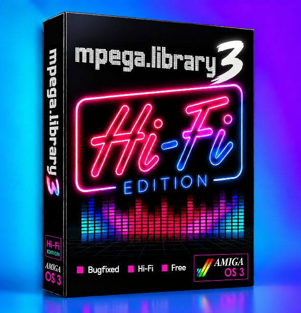

# mpega.library



A new version of mpega.library by Ján Zahurančík, based on S. Skjæret's &
G. Steger's [libmad edition of
mpega.library](https://aminet.net/util/libs/mpega_libmad.lha) for AmigaOS 3
(68020). It decodes MPEG audio (layers I, II and III) with libmad. Programs
that use mpega.library (AmigaAMP, AMPlifier, TKPlayer, ...) work unchanged:
just replace the library.

**VERSION 3 COMES IN THREE FLAVOURS:**

- **`-bugfix`** (`mpega.library-bugfix`): the original decoder, just fixed.
  It no longer crashes or freezes where the old one did: with some players
  (those that give it little memory to work in), on MP3s with a loudness
  (ReplayGain) tag, on damaged files. Music streamed from the network
  plays to the end. Every track plays to its very last note. Mono keeps
  both channels. Jumping within a track lands where you asked. Very loud
  MP3s (made louder with MP3Gain, say) still crackle, as they always did;
  `-hifi` plays them.

- **`-hifi`** (`mpega.library-hifi`): every fix of `-bugfix`, and on top of
  that it calculates with much higher precision, so the music comes out
  cleaner, and MP3s that were made louder than a CD allows still play
  without crackle. It needs about 1.5 times the CPU of `-bugfix` on a real
  Amiga (2 to 3 times in emulation, where there is CPU to spare), and it
  follows the player's settings (quality, frequency, mono, volume,
  loudness tag).

- **`-hifi-forced`** (`mpega.library-hifi-forced`): the `-hifi` decoder,
  always at the highest quality. Some players ask for lower quality or a
  lower sample rate to save CPU; this one ignores that, and it ignores the
  loudness tag, so you always hear the file as it was made. Volume and mono
  still work. It also plays through small errors in a file instead of
  stopping. For fast Amigas and emulation.

All three flavours contain every fix; they differ only in how they decode.

## Installation

Requires AmigaOS 3 and a 68020 or faster CPU. Well, rather faster one,
definitely. No FPU required.

1. Copy your preferred flavour (see above) to `LIBS:mpega.library`,
   replacing the old one (keep a backup if you like).
2. Reboot, or quit your player and run `Avail FLUSH` so that the new
   library is loaded.

Nothing to configure: your player and AHI settings stay as they are.
`version LIBS:mpega.library` shows which flavour is installed, e.g.
`[020] [Hi-Fi] [64bit]`.

## Speed

CPU needed to play an ordinary 128 kb/s stereo MP3 at full quality; above
100 % the music stutters.

- 68020: measured (in WinUAE with exact timing, scaled to the clock). A
  68030 at the same clock does a little better.
- 68040 and 68060: estimated; the real numbers are, if anything, lower.

| CPU | 2004 original | 2026 `-bugfix` | 2026 `-hifi` | |
|---|---|---|---|---|
| 68020 at 50 MHz | 370 % | 370 % | 550 % | measured |
| 68040 at 40 MHz | 80 % | 80 % | 115 % | estimated |
| 68060 at 50 MHz | 40 % | 40 % | 60 % | estimated |

- On a real Amiga `-bugfix` is as fast as the original.
- In emulation (measured in WinUAE) `-bugfix` is up to 25 % faster than
  the original.
- On a 68020 or 68030 your player lowers the quality or the sample rate,
  as it always did, and `-bugfix` and `-hifi` go along with it.
- In emulation there is CPU to spare: take `-hifi` there.

## Accuracy

- Four full tracks were decoded with `-hifi` and compared, sample by
  sample, with ffmpeg, the decoder most computers use.
- The output never differs by more than one step of the 65 536 a 16-bit
  output has, before the dither it adds on purpose (a trace of noise, as on
  every CD); far below anything you can hear.
- Every track plays to its very last note; the 2004 original cuts the end
  of each one short.
- Also tested with the players above, two of them playing at once.

| Track | Kind of MP3 | Result |
|---|---|---|
| AmiKit X13 theme | variable bitrate, 48 kHz | matches |
| AmiKit X13 theme (remix) | variable bitrate, 48 kHz, very loud | matches |
| Sundial Aeon - Startup Sequence | 320 kb/s, with a loudness tag | matches |
| The Future Sound of London - Smokin Japanese Babe | 128 kb/s, the usual kind | matches |

## What was fixed

All three flavours carry the same two dozen fixes to the 2004 libmad
clone. The ones you were most likely to run into:

- It crashed with players that give it little memory to work in.
- Music from the network, a pipe, the serial port or a CD stopped after a
  few seconds. It now plays to the end.
- Every track lost its last fraction of a second, and the shown length was
  a little short.
- Mono dropped the right channel. Both channels are now mixed.
- Jumping to a point under one second restarted the track, and jumping
  into some files failed on perfectly good audio.
- Files under 2 KB would not open, and some tags corrupted memory.
- MP3s with a loudness (ReplayGain) tag froze the whole machine. The tag
  now works.
- A file ending in an old-style (ID3v1) tag reported an error instead of a
  clean end.
- Two players can play at the same time.
- Damaged or hostile files fail cleanly instead of crashing (the 2017
  libmad security fixes). Good files play exactly as before.

The full list is in [`CHANGELOG.md`](CHANGELOG.md).

## Building

```sh
make
```

builds `mpega.library-bugfix`, `mpega.library-hifi` and
`mpega.library-hifi-forced` (individually: `make mpega.library_020_bugfix`,
`_020_hifi`, `_020_hifi_forced`). Needs the amiga-gcc cross toolchain
(`m68k-amigaos-gcc`) in `PATH`, GNU make and `python3` (every build checks
the linked library for the stack-swap defect). The flavours differ in build
flags only: `-bugfix` uses `FPM_DEFAULT` / `OPT_SPEED` / `OPT_SSO`, the Hi-Fi
flavours `FPM_64BIT` + `OPT_ACCURACY`, and `-hifi-forced` adds
`MPEGA_FORCE_HIFI`. Only AmigaOS 3 / 68020 is built; the 2004 PPC, OS4, AROS
and 040 targets were removed, and their sources and binaries live on in
`original-archives/`.

Tests: `make check` runs the host regression harness, `make check-m68k`
runs the built libraries under vamos. See [`tests/README.md`](tests/README.md).

## Repository layout

| Path | What |
|------|------|
| `library_init.c/.h`, `library_base.h` | Library boilerplate / init |
| `wrap_mpega.c/.h` | The mpega API wrapper over libmad |
| `support.c/.h` | Memory pool and string helpers |
| `mad/` | Robert Leslie's libmad 0.15.1b plus the hardening upstream folded in at 0.16.0, modified for 68k |
| `mpega.fd` | Library FD (function table, register arguments) |
| `Makefile` | 68020 build of the three flavours |
| `include_aros/libraries/mpega.h` | The public API header |
| `original-archives/` | Pristine upstream archives, byte for byte |
| `tests/` | Regression harness, fixtures and the on-Amiga benchmark |

## Credits

These authors had no part in this version:

- **Stephane Tavenard**: the original mpega.library (1999)
- **Sigbjørn Skjæret (CISC)**: the libmad-based clone (2004)
- **Robert Leslie**: libmad (in [`mad/`](mad/))
- **Jarmo Laakkonen**: WarpOS version (2004)
- **Stephan Rupprecht**: OS4 version (2004)
- **Georg Steger**: AROS i386 port (2006)

Their sources are kept byte for byte under `original-archives/`:
`mpega_libmad.lha` (the 7th release, 68k/PPC/OS4/MorphOS) and
`mpega_libmad.i386.tar.bz2` (the AROS port, whose 68k path is identical).

## Thanks

To **Midwan**, for the initial analysis of the first builds and his
suggestions, which set the direction of the whole effort, to **Philipp
Lonke** and **Falcon_11**, for beta testing, and others who helped make this
happen.

## License

Licensed under the **GNU GPL v2** (because libmad is GPL). See
[`mad/COPYING`](mad/COPYING), [`mad/COPYRIGHT`](mad/COPYRIGHT) and
[`mad/CREDITS`](mad/CREDITS). Applications using this library must be GPL too.
The complete source is on GitHub: https://github.com/AmiKit/mpega_library_3.
